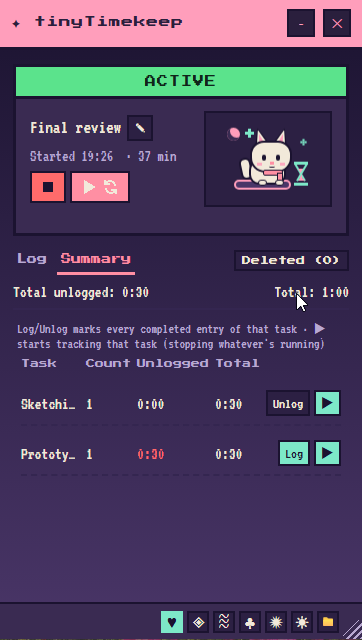
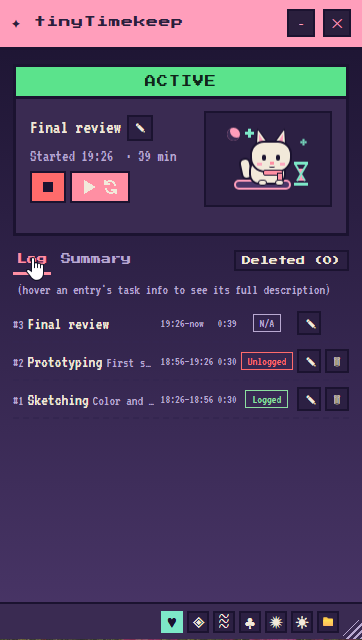
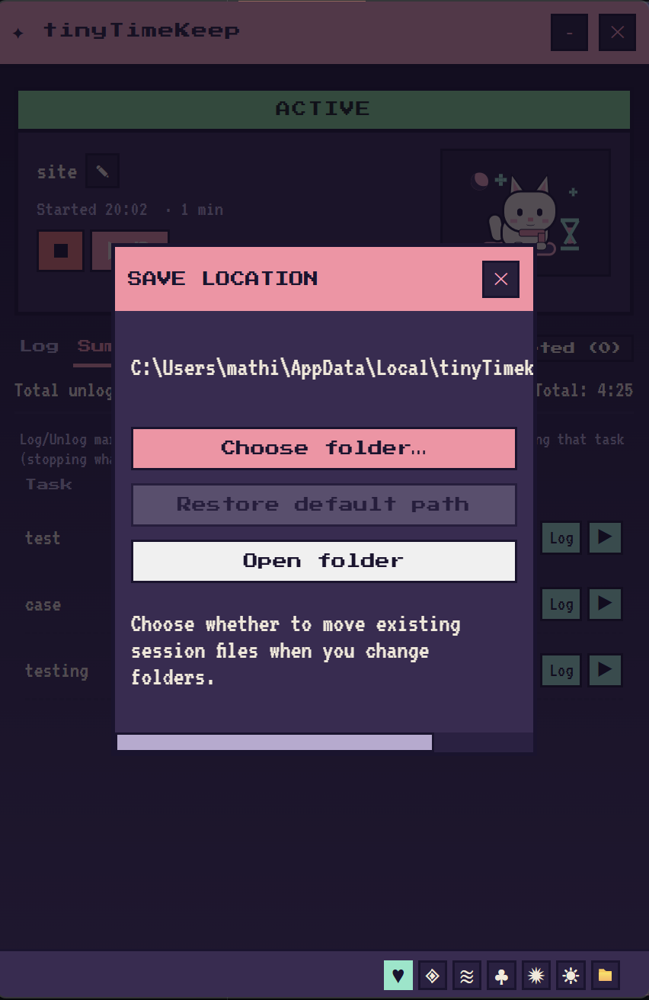
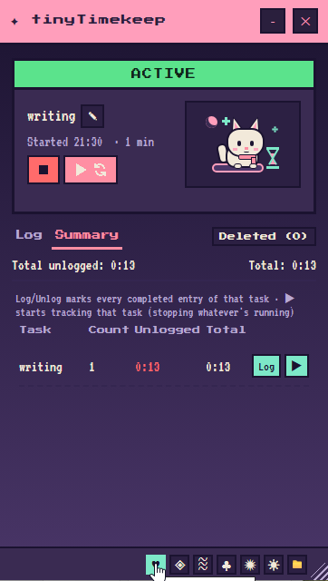
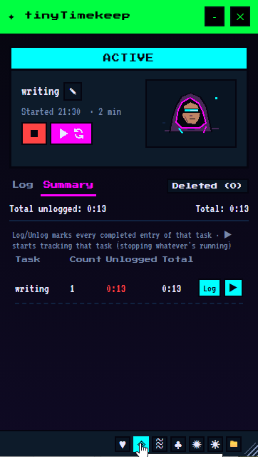
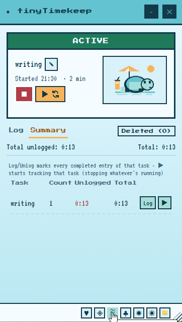
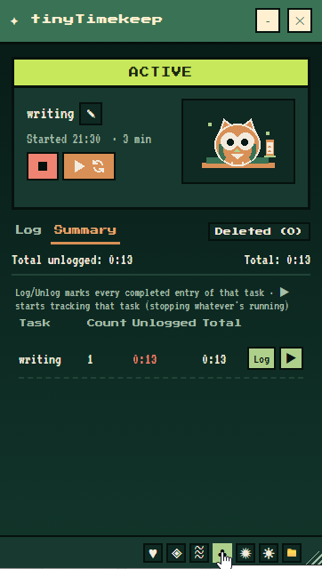
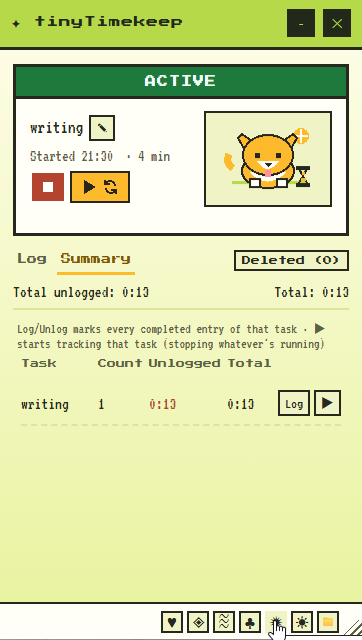
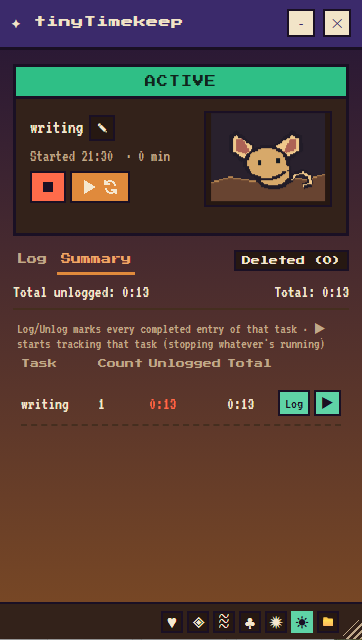

# tinyTimeKeep

tinyTimeKeep is a small Windows desktop app for tracking time in sessions. Start a
session, switch between tasks as you work, then review your entries and totals.

## Screenshots





## Themes

The active tracking screen in all six supported themes:

<p>
<span><a href="docs/screenshots/themes/cute.png"></a></span><span><a href="docs/screenshots/themes/cyber.png"></a></span><span><a href="docs/screenshots/themes/poolside.png"></a></span><br>
<span><a href="docs/screenshots/themes/evergreen.png"></a></span><span><a href="docs/screenshots/themes/citrus-pop.png"></a></span><span><a href="docs/screenshots/themes/dune.png"></a></span>
</p>

## Download and run

1. Open the [tinyTimeKeep releases page](https://github.com/sweatyeti/tiny-timekeep/releases).
2. Open the newest release and download the executable shown under its **Assets**
   section. As of the full v1.0 release, the name is `tinyTimeKeep.exe`.
3. Run the downloaded file. There is no installer.

The published app is for Windows and requires the Microsoft Edge WebView2 Runtime,
which is normally included with Windows 10 and 11. The executable is unsigned, so
Windows may show a SmartScreen warning. Download it only from the project's releases
page.

The app loads its pixel fonts from Google Fonts, so an internet connection may be
needed for the fonts to appear as intended.

## Track your time

1. Choose **Start new session**. A session name and first task are optional. To continue
   an earlier session, select it from the resume list instead.
2. Use the play button in the tracking panel to start a task or switch to another one.
   You can give a task an optional description. Use the stop button to stop tracking;
   closing the window also stops tracking and exits the app.
3. Open **Log** to review and edit entries. Open **Summary** to see time totals by
   task. In Summary, **Log** and **Unlog** mark all completed entries for a task, and
   the play button starts tracking that task.

## Correct time or add missed work (feature branch)

- In **Log**, choose **Add missed time** to add a completed interval to the open session.
  Enter a task, optional description, and explicit start/end timestamps.
- Click an underlined **completed time range** in Log to correct its start and end.
  The pencil remains the task/description/Logged editor. Stop a running entry before
  correcting its time.
- Times include a date, seconds, and UTC offset, for example `2026-10-12T09:00:00-05:00`.
  `Z` means UTC. Prefilled times use the computer's local offset for each timestamp;
  when changing dates across daylight saving time, check the offset too.
- End must be after start and not in the future. Intervals cannot overlap another visible
  entry in the same session; touching endpoints are allowed. Earlier work can predate
  the session. Deleted entries and other sessions are outside the overlap check.
- Changing a recorded time marks that entry **Unlogged** again, even if its duration
  stays the same; update any external time record as needed. Saving unchanged times
  preserves Logged. New intervals start Unlogged.
- Cancel or Escape changes nothing. Validation errors keep your inputs so you can fix them.
  Adding/correcting time does not stop your running timer. Existing session files need no migration.

## Session files and save location

By default, every installation saves session files on this PC in:

`%LOCALAPPDATA%\tinyTimeKeep\sessions`

Preferences—including the selected theme and any custom save location—are stored in:

`%LOCALAPPDATA%\tinyTimeKeep\preferences.json`

On most Windows PCs, `%LOCALAPPDATA%` points to a folder under your Windows user
account, typically `C:\Users\<your-name>\AppData\Local`.

Use the folder button in the app's bottom toolbar to see or open the current folder,
choose a different folder, or restore the default path. Your choice is remembered for
future launches. When changing folders, the app asks whether to move existing session
files. If you choose to move them, existing session files go to the selected folder. If
you decline, the active session is still moved there so tracking can continue, while
other existing session files remain in the old folder. New sessions are saved in the
selected folder.

## Troubleshooting

- If the app does not open, check that the WebView2 Runtime is installed.
- If the app's pixel fonts do not load, check your internet connection. The interface
  may still open with fallback fonts.
- If Windows displays a SmartScreen warning, remember that the current executable is
  unsigned and verify that you downloaded it from the official releases page.

## For contributors

The Windows build targets Python 3.14.7. From the repository root, create an
environment, install the app and development dependencies, then run the checks:

```powershell
py -3.14 -m venv .venv
.venv\Scripts\python -m pip install -r requirements-dev.txt
.venv\Scripts\python main.py --check
.venv\Scripts\python -m unittest discover -s tests
```

To run from source on Windows, use `.venv\Scripts\python main.py`. The Windows
executable is built with `packaging\build.ps1`.
